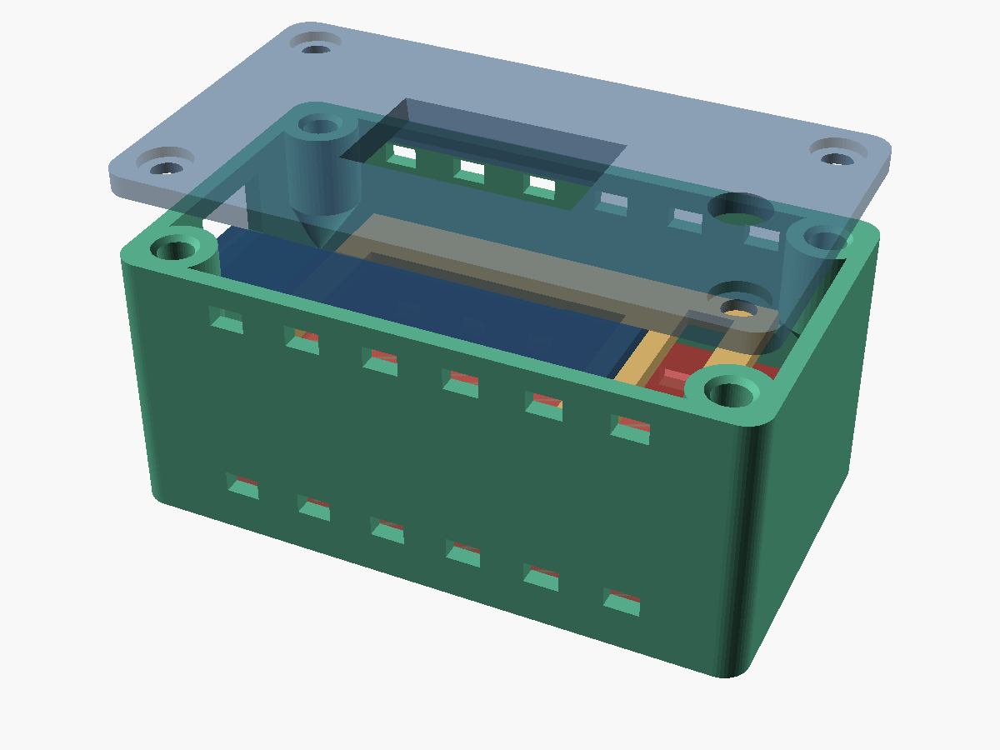

# Heltec V3 case (WY6Y Pop Repeater)

A three-part case for a Heltec WiFi LoRa 32 V3 sitting over a 3000 mAh 103665 LiPo
(36 x 10 x 65 mm, JST 1.25), with the stock antenna standing straight up from an
SMA jack in the lid. Built for a MeshCore repeater and observer in a window.



- Outside: 72.2 x 41.2 x 34.3 mm
- Parts: `base.stl`, `tray.stl`, `lid.stl` (the lid is exported upside down, ready to print)
- No supports. PLA is fine indoors out of direct sun; PETG or ASA for a hot sill.
- Hardware: 4 x M3 x 4 x 5 mm brass heat-set inserts (4.1 mm holes in the posts),
  4 x M3 x 8 machine screws, the V3's u.FL to SMA pigtail.
- Press the inserts in flush with a soldering iron (about 220 C for PLA) before assembly.

Assembly:
1. Battery flat on the floor, lead at the USB end.
2. Tray onto the wall ledges, lead up through the tray's window.
3. Plug the battery into the board's JST (underneath, USB end), then drop the board
   OLED-up into the tray's pocket, USB end toward the USB opening. The pocket's side
   walls and far-end stop keep it from sliding; the lid ribs hold it down.
4. Pigtail jack through the lid, u.FL onto the board, lid on, 4 screws.

USB-C reaches the board through a 14 x 9 mm tunnel in the end wall (the board sits
about 8 mm in, clear of the corner posts). The RST and PRG buttons have no holes;
lift the lid to reach them.

`part="check"` renders the overlaps of board, base, tray and lid; each should be
empty apart from the intended contacts (board on the ledges, lid ribs on its edges).

v2 (2026-11-21): v1's USB-end screw posts overlapped the board corners, the tray had
nothing to stop the board sliding, and a solid strip sat under the battery plug.
Reprint all three parts.

v3 (2026-11-22): the v2 tray could walk about 1.6 mm toward the USB end and the board
had no stop on that side, so pulling the USB-C plug dragged everything along. Two
blocks now run from the USB end wall to the board, one on each side of the plug, and the
plate reaches the far wall, so the tray is locked in the base and the board is stopped
both ways. The lid lip has a 13 mm gap round the SMA hole, so a flat washer, star washer
and nut can sit flat under the lid (v3.2; v3 also moved the hole 2.5 mm inward,
which hit the board, so it is back in the v2 spot). Base unchanged:
reprint the tray and lid only (`part="plate"` puts both on one bed).

Board dimensions come from Heltec's V3 drawing (50.2 x 25.5 mm, 10.2 mm thick,
OLED module 5 mm; USB-C on the OLED side). Change anything in the parameters at
the top of `heltec-v3-case.scad`, then export:

```
openscad -D 'part="base"' -o base.stl heltec-v3-case.scad
openscad -D 'part="tray"' -o tray.stl heltec-v3-case.scad
openscad -D 'part="lid"'  -o lid.stl  heltec-v3-case.scad
openscad -D 'part="plate"' -o plate.stl heltec-v3-case.scad   # tray + lid together
```

Header pins are left off (a repeater doesn't need them; soldered pins would hit the
rails). Before printing, check the room under the board for the battery plug (5 mm
allowed). The SMA hole is plain 6.6 mm; tighten the pigtail's nut.
